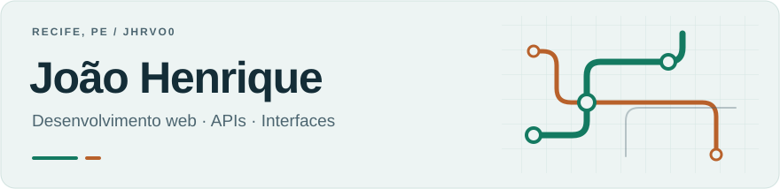

<picture>
  <source media="(prefers-color-scheme: dark)" srcset="./assets/profile-header-dark.svg">
  <source media="(prefers-color-scheme: light)" srcset="./assets/profile-header-light.svg">
  
</picture>

  Sou recifense, estudante de <strong>Ciência da Computação na CESAR School — 6º período</strong>
  e estagiário de desenvolvimento no <strong>Grande Recife Consórcio de Transporte</strong>.
  Entre o estágio e a faculdade, trabalho com aplicações web e mobile e exploro acessibilidade, hardware e jogos.

  <a href="https://www.linkedin.com/in/jo%C3%A3o-henrique-oliveira-585b91291/"><strong>LinkedIn ↗</strong></a>
  &nbsp;·&nbsp;
  <a href="mailto:joaohrvo@gmail.com"><strong>E-mail ↗</strong></a>
  &nbsp;·&nbsp;
  <a href="#projetos"><strong>Projetos ↓</strong></a>

## Grande Recife · RUMO

**Estágio em desenvolvimento · Mobilidade urbana**

Contribuo para o **RUMO**, plataforma de informação e planejamento de viagens no transporte público da Região Metropolitana do Recife. Minha atuação passa pelas interfaces que o passageiro utiliza e pelos dados que sustentam essas informações:

- **Web e mobile** — interfaces com Vue, TypeScript e Capacitor.
- **APIs e integração de dados** — Python/Django, linhas, itinerários, horários e paradas.
- **Mapas e planejamento de viagens** — Leaflet e apresentação dos trajetos.
- **Acessibilidade e qualidade da informação** — evolução das interfaces e validação dos dados apresentados aos passageiros.

## Projetos

<table>
  <tr>
    <td width="50%" valign="top">
      
APLICAÇÃO WEB · PROJETO EM EQUIPE

      <h3><a href="https://github.com/AntonioPaess/Murall">Murall ↗</a></h3>
      
Plataforma de anúncios comunitários para pequenos sites e blogs trocarem espaços de divulgação. Participei da equipe VEROS, que reúne estudantes de Computação e Design.

      
<code>Java</code> <code>Spring Boot</code> <code>Next.js</code> <code>PostgreSQL</code>

      
<a href="https://github.com/AntonioPaess/Murall">Ver repositório →</a>

    </td>
    <td width="50%" valign="top">
      
ACESSIBILIDADE · EM DESENVOLVIMENTO

      <h3>BrailleTutor</h3>
      
Protótipo para o ensino de Braille que integra software, ESP32 e mecanismos de atuação tátil. Um projeto para explorar a conexão entre programação, hardware e aprendizagem.

      
<code>Python</code> <code>ESP32</code> <code>CAD</code>

      
Protótipo em desenvolvimento.

    </td>
  </tr>
  <tr>
    <td width="50%" valign="top">
      
APLICAÇÃO WEB · PROJETO ACADÊMICO

      <h3><a href="https://github.com/jhrvo0/Rizoma">Rizoma ↗</a></h3>
      
Projeto em equipe voltado à organização de áreas e atividades de pequenos agricultores, com foco em plantio, colheita e manejo.

      
<code>Python</code> <code>Django</code> <code>PostgreSQL</code>

      
<a href="https://github.com/jhrvo0/Rizoma">Ver repositório →</a>

    </td>
    <td width="50%" valign="top">
      
JOGO 2D · EM DESENVOLVIMENTO

      <h3>M.A.G. — Através dos Universos</h3>
      
Jogo 2D em C e Raylib. Explora universos que mudam as regras e a dinâmica de cada partida, combinando programação e mecânicas de jogo.

      
<code>C</code> <code>Raylib</code>

      
Projeto em desenvolvimento.

    </td>
  </tr>
</table>

---

Recife, Pernambuco · Interfaces, APIs e projetos que conectam software ao cotidiano.
